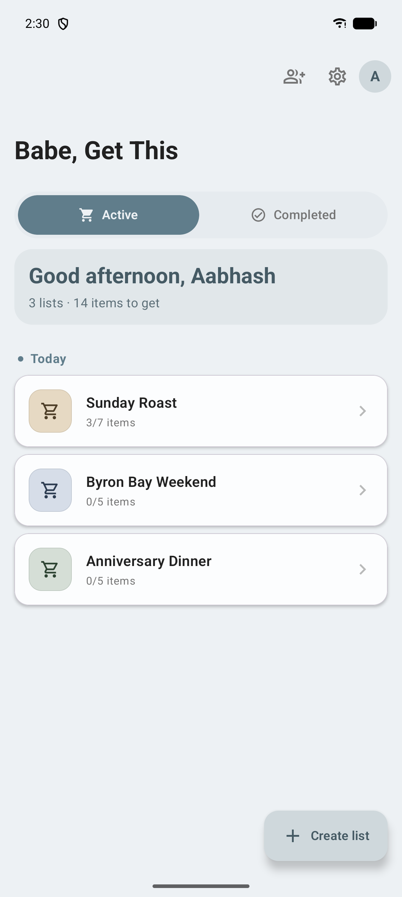
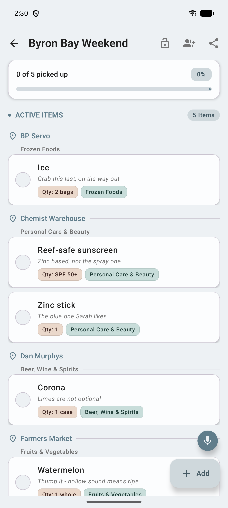
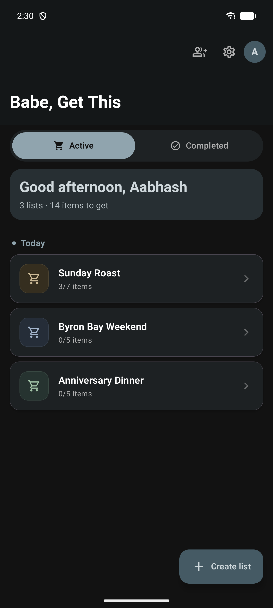

# Babe, Get This

[](https://github.com/AabhashRai13/Babe-get-this/actions/workflows/build-aab.yml)
[](https://github.com/AabhashRai13/Babe-get-this/actions/workflows/instrumented-tests.yml)

An offline-first shared shopping list app for couples, built with Jetpack Compose and Material 3.

| Home | A list, by shop | Dark theme |
| :--: | :--: | :--: |
|  |  |  |

## Features

- Multiple lists with real-time sync between partners via a shared list code
- Voice capture: dictate groceries into a new, auto-named list
- Items with quantity, category, notes and shop; tap to pick up, undo on delete
- Got This: "Bought 3 days ago" hints, suggestions and a weekly heads-up
- A reminder for items left unticked after a shop
- Share a list as plain text
- Fully usable offline (Room is the source of truth)

## Tech stack

Kotlin · Jetpack Compose + Material 3 · MVVM + Repository · Coroutines/Flow · Hilt · Room · Supabase auth · Retrofit. Min SDK 24, target SDK 36, JDK 17.

Code lives in `app/src/main/java/com/babegetthis/android/`: shared building blocks under `core/`, and each screen under `feature/<name>/{data,model,ui}`.

## Getting started

The `dev` flavour uses fake auth, so a fresh clone builds with no configuration:

```bash
./gradlew installDevDebug
```

For `staging`/`prod`, add Supabase keys to `local.properties` (gitignored). Release signing keys (`RELEASE_STORE_FILE`, `RELEASE_STORE_PASSWORD`, `RELEASE_KEY_ALIAS`, `RELEASE_KEY_PASSWORD`) are optional; without them the release build is unsigned.

```properties
SUPABASE_URL=https://your-project.supabase.co
SUPABASE_ANON_KEY=your-anon-key
```

| Variant   | Application ID                    | Backend                  |
| --------- | --------------------------------- | ------------------------ |
| `dev`     | `com.babegetthis.android.dev`     | Fake auth                |
| `staging` | `com.babegetthis.android.staging` | Staging Supabase project |
| `prod`    | `com.babegetthis.android`         | Production               |

Google sign-in setup (OAuth clients, SHA-1 fingerprints): [docs/publishing/google-sign-in.md](docs/publishing/google-sign-in.md).

## Common commands

```bash
./gradlew spotlessApply                     # Format
./gradlew lintProdDebug                     # Lint (warnings are errors)
./gradlew testDevDebugUnitTest              # Unit + Compose tests on the JVM
./gradlew koverVerifyDevDebug               # Coverage gate (100% on logic layer)
./gradlew connectedDevDebugAndroidTest      # End-to-end, needs an emulator
./gradlew bundleProdRelease                 # Minified release bundle
```

Tests need no network or credentials; backends are faked. See [docs/running-tests.md](docs/running-tests.md) for details.

## Contributing

Open an issue before changes to scope or architecture, keep PRs focused, and run `spotlessApply`, `lintProdDebug`, `testProdDebugUnitTest` and `koverVerifyDevDebug` before pushing. CI blocks on all four.

## Roadmap

- [ ] Auto-categorization of common items
- [ ] Camera and gallery capture with item autofill
- [ ] Pantry: carry completed items over to the next list
